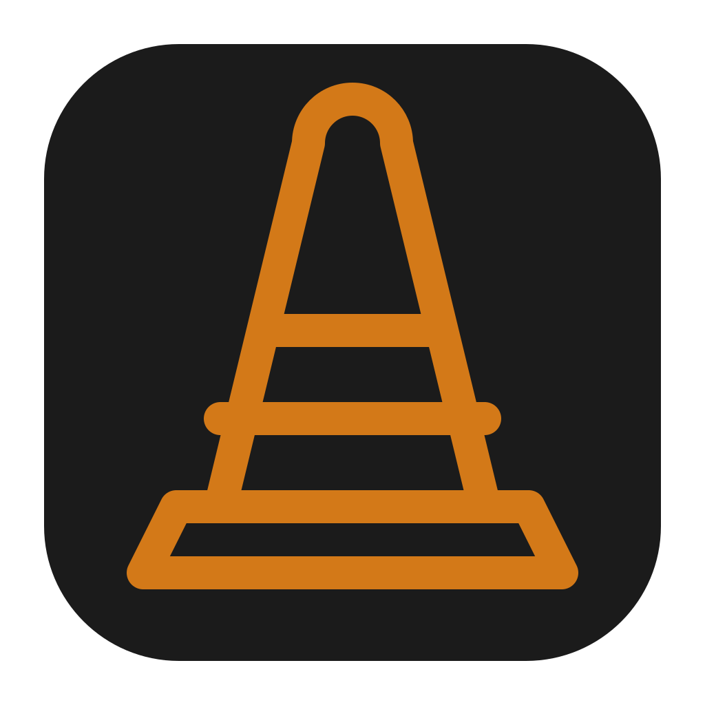
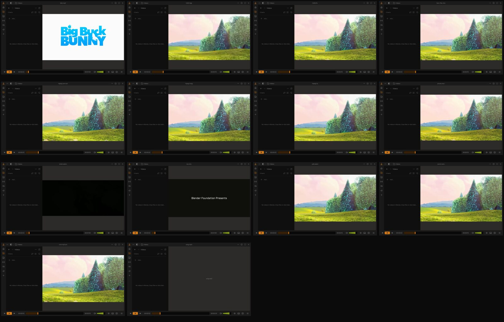

<div align="center">
  
  <h1>Konus</h1>
  <p>A fresh take on VLC, built for everyday watching.</p>
  <p>
    <a href="https://github.com/luvor/konus/actions/workflows/build.yml"></a>
    <a href="https://github.com/luvor/konus/releases/latest"></a>
    <a href="LICENSE"></a>
    
  </p>
  <p><a href="https://luvor.github.io/konus/">Website</a> · <a href="https://github.com/luvor/konus/releases/latest">Download</a> · <a href="https://www.figma.com/community/file/1691465999134370980">Design credit</a></p>
</div>

Konus is a fan-built, working take on **Juxtopposed**’s VLC redesign, made after watching [I Redesigned VLC After 25 Years](https://www.youtube.com/watch?v=ERFeOgqk324) on [her channel](https://www.youtube.com/@juxtopposed). The design is hers ([Figma, CC BY 4.0](https://www.figma.com/community/file/1691465999134370980)); playback is VLC’s, through libVLC. Konus is not affiliated with VideoLAN or Juxtopposed.


## Tested with real files



Checked on macOS with the packaged app.

| Type | Container | Video | Audio |
| --- | --- | --- | --- |
| Video | MP4 | H.264 | AAC |
| Video | WebM | VP9 | Opus |
| Video | MKV | AV1 | Opus |
| Video | AVI | XviD | MP3 |
| Video | AVI | MJPEG | PCM |
| Video | MOV | ProRes | — |
| Video | FLV | H.264 | — |
| Video | MPEG-TS | MPEG-2 | — |
| Video | WMV | WMV2 | — |
| Video | MPEG | MPEG-1 | — |
| Video | MKV | HEVC | FLAC |
| Video | 3GP | H.263 | — |
| Video | WebM | VP8 | Opus |
| Audio | — | — | MP3, FLAC, OGG Vorbis, Opus, M4A AAC, WAV |

## Download

Get a packaged build from [Releases](https://github.com/luvor/konus/releases/latest). Development builds are attached to successful [GitHub Actions](https://github.com/luvor/konus/actions/workflows/build.yml) runs.

- **macOS (Apple silicon, macOS 14.4+):** unzip `konus-macos.zip` and open `konus.app`. It is ad-hoc signed and not notarized. On macOS 14 or earlier, right-click and choose **Open**. On macOS 15 or later, try opening it, then use **System Settings → Privacy & Security → Open Anyway** if blocked ([Apple’s instructions](https://support.apple.com/en-gb/102445)).
- **Windows:** unzip `konus-windows.zip` and run `konus.exe`. The ZIP includes the MSVC runtime DLLs. If SmartScreen warns, choose **More info → Run anyway** after checking the download came from this repository.
- **Linux (x86_64):** download `konus-linux.AppImage`, then run `chmod +x konus-linux.AppImage` and `./konus-linux.AppImage`. If FUSE is unavailable, run `./konus-linux.AppImage --appimage-extract-and-run`.

## Features

- Dark player with a collapsible media library and custom title bar.
- Video playback through libVLC with Qt video output.
- Keyboard controls, drag and drop, file picker, and subtitle/audio track selection.
- Media library from the platform’s standard Videos and Music folders.

## Keyboard shortcuts

| Shortcut | Action |
| --- | --- |
| Space | Play / pause |
| ← / → | Seek backward / forward 5 seconds |
| Shift + ← / → | Seek backward / forward 30 seconds |
| ↑ / ↓ | Raise / lower volume by 5% |
| M | Mute / unmute |
| F | Toggle fullscreen |
| Esc | Close search, or leave fullscreen |
| Ctrl + O (Windows/Linux), Cmd + O (macOS) | Open a media file |

When a library list or volume control has focus, the arrow keys control that widget.

## Library folders

| Platform | Videos | Music |
| --- | --- | --- |
| macOS | `~/Movies` | `~/Music` |
| Windows | `%USERPROFILE%/Videos` | `%USERPROFILE%/Music` |
| Linux | `~/Videos` | `~/Music` |

Qt’s standard folder locations are used, so redirected Windows folders and Linux XDG user-directory settings take precedence.

## Build

Requirements: CMake 3.21+, a C++17 compiler, Qt 6.5+ (Quick, QuickControls2, Multimedia, Svg), and libVLC 3.

### macOS

Install Qt 6 and VLC, then run:

```sh
cmake -S . -B build -DCMAKE_PREFIX_PATH="$(brew --prefix qt)" -DCMAKE_BUILD_TYPE=Release
cmake --build build -j
```

### Windows

Install Qt 6.8.3 for MSVC 2022 64-bit (including Qt Multimedia) with the Qt online installer. Extract the [VLC 3.0.23 archive](https://download.videolan.org/pub/videolan/vlc/3.0.23/win64/vlc-3.0.23-win64.7z) to `C:/vlc-3.0.23`. From a Visual Studio x64 developer shell:

```powershell
cmake -S . -B build -DVLC_SDK_DIR=C:/vlc-3.0.23/sdk -DCMAKE_PREFIX_PATH=C:/Qt/6.8.3/msvc2022_64
cmake --build build --config Release
```

### Linux

CI builds the AppImage on Ubuntu 22.04 for an older glibc baseline. On Ubuntu 22.04 or 24.04, install Qt 6.8.3 modules with `aqtinstall`:

```sh
sudo apt-get update
sudo apt-get install -y build-essential cmake pkg-config python3-venv libvlc-dev libvlc5 vlc-plugin-base libgl1-mesa-dev libxkbcommon-dev libxkbcommon-x11-0 libxcb-cursor0
python3 -m venv .venv-aqt
.venv-aqt/bin/python -m pip install aqtinstall
.venv-aqt/bin/aqt install-qt linux desktop 6.8.3 linux_gcc_64 --modules qtmultimedia --outputdir "$HOME/Qt"
export CMAKE_PREFIX_PATH="$HOME/Qt/6.8.3/gcc_64"
cmake -S . -B build -DCMAKE_BUILD_TYPE=Release
cmake --build build -j
```

At runtime, the build uses Qt’s shared libraries and system libVLC plugins. Keep `libvlc5`, `vlc-plugin-base`, `libxkbcommon-x11-0`, and `libxcb-cursor0` installed.

## Local checks

`KONUS_GRAB=/tmp/grab.png <app> <media>` reveals the UI, captures it, and exits. Add `KONUS_GRAB_HIDDEN=/tmp/grab-hidden.png` to capture video alone after the 2.5-second idle timer; keep the pointer still. A failed save or UI still visible on the second capture exits with code 2.

For the dropped-picture regression check, configure with `-DKONUS_BUILD_FRAME_CHECK=ON`, build, then run `build/konus-frame-check`. It forces 64 lock/unlock pairs and checks RSS growth (under 16 MiB on macOS), copied pixels, row alignment, queued-frame limits, and format changes. RSS comparison is skipped elsewhere. The player has no per-frame debug counter.

## Contributing

See [CONTRIBUTING.md](CONTRIBUTING.md) for the short guide.

## Credits

- **Design:** Juxtopposed’s [Figma redesign](https://www.figma.com/community/file/1691465999134370980), based on [I Redesigned VLC After 25 Years](https://www.youtube.com/watch?v=ERFeOgqk324), used under [CC BY 4.0](https://creativecommons.org/licenses/by/4.0/). Konus adapts the layout and interactions in Qt/QML and includes original cone artwork.
- **Playback:** [libVLC](https://www.videolan.org/) from VideoLAN. Not affiliated with VideoLAN; VLC is a VideoLAN trademark.
- **UI framework:** [Qt](https://www.qt.io/); notices and license terms are in [NOTICE](NOTICE) and [LICENSES](LICENSES/).
- **Font:** Inter by Rasmus Andersson is bundled under the SIL Open Font License 1.1 ([OFL](assets/fonts/OFL.txt)).
- **Film stills:** [Sintel](https://durian.blender.org/) and [Tears of Steel](https://mango.blender.org/) © Blender Foundation, [CC BY 3.0](https://creativecommons.org/licenses/by/3.0/).
- **Icons:** selected [Hugeicons](https://hugeicons.com/) artwork is under the MIT License ([notice](assets/icons/LICENSE-hugeicons.txt)).

## License

Konus is licensed under the GNU General Public License, version 3 or (at your option) any later version. See [LICENSE](LICENSE), [NOTICE](NOTICE), and [LICENSES](LICENSES/) for third-party terms.
