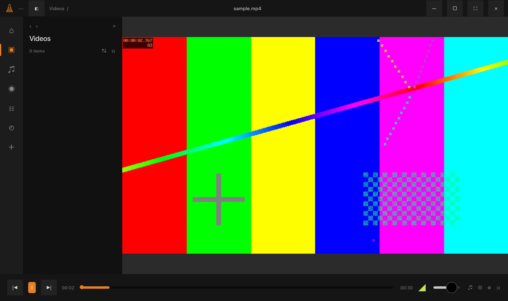

# Konus

Konus is an open-source desktop video player built with Qt 6 QML and libVLC 3, bringing Juxtopposed's VLC redesign concept to a working player with a media library, responsive playback controls, keyboard shortcuts, drag and drop, and subtitle/audio track selection.



## Features

- Dark player with collapsible media library and custom title bar.
- Video playback through libVLC with a Qt video output.
- Space, arrows, M, F, Escape, drag and drop, and file picker controls.
- Videos from `~/Movies`; music from `~/Music`.

## Build

Requirements: CMake 3.21+, C++17 compiler, Qt 6.4+ (Quick, QuickControls2, Multimedia, Svg), and libVLC 3.

### macOS

Install Qt 6 and VLC, then run:

```sh
cmake -S . -B build -DCMAKE_PREFIX_PATH="$(brew --prefix qt)" -DCMAKE_BUILD_TYPE=Release
cmake --build build -j
```

### Windows

Install Qt 6 using the Qt online installer and download the [VLC 3.0.23 SDK](https://download.videolan.org/pub/videolan/vlc/3.0.23/win64/vlc-3.0.23-win64.7z). Point `VLC_SDK_DIR` to its extracted `sdk` directory:

```powershell
cmake -S . -B build -DVLC_SDK_DIR=C:/vlc/sdk -DCMAKE_PREFIX_PATH=C:/Qt/6.8.0/msvc2022_64
cmake --build build --config Release
```

### Linux

Install Qt 6 development modules and libVLC development packages (for Ubuntu: `qt6-base-dev qt6-declarative-dev qt6-multimedia-dev qt6-svg-dev libvlc-dev vlc-plugin-base`), then run:

```sh
cmake -S . -B build -DCMAKE_BUILD_TYPE=Release
cmake --build build -j
```

## Credits

Design by [Juxtopposed](https://www.figma.com/community/file/1691465999134370980), based on [I Redesigned VLC After 25 Years](https://www.youtube.com/watch?v=ERFeOgqk324), used with CC BY 4.0 attribution. Playback engine: [libVLC by VideoLAN](https://www.videolan.org/).

Not affiliated with VideoLAN. VLC is a trademark of VideoLAN.
